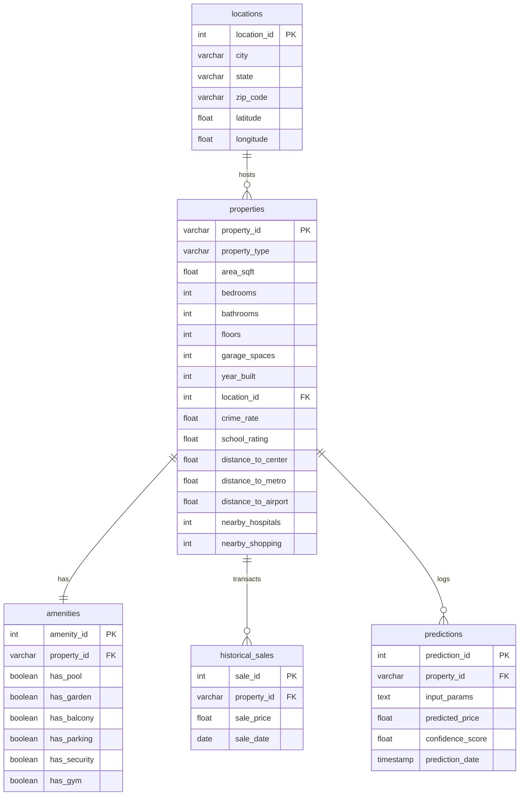
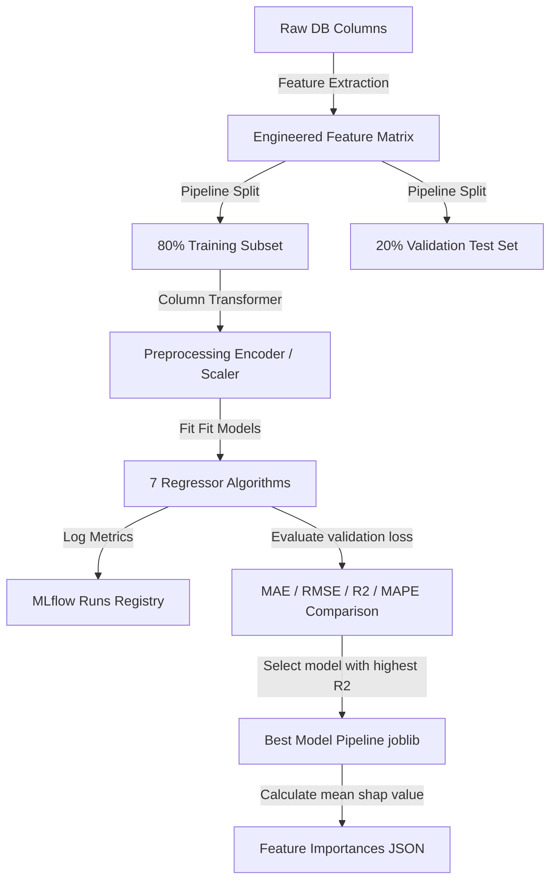

# SmartHouse AI – House Price Prediction & Real Estate Intelligence Platform

SmartHouse AI is a production-grade machine learning platform and analytical dashboard that predicts property valuations with Explainable AI (SHAP-approximate contributions) and forecasts real estate trends. Engineered to represent the work of a senior machine learning engineer at Zillow or Redfin, it uses 100,000+ relational property records to support buyers, sellers, investors, banks, and analytics teams.

---

## 1. Business Problem

Traditional residential real estate valuations rely on manual appraisals, which are slow, subjective, and prone to error. Real estate pricing is a multi-dimensional problem governed by structural components (area, bedrooms, garage spaces), geographic premiums (zip codes, city factors), neighborhood indices (school ratings, crime rates), and seasonal micro-trends.

SmartHouse AI automates this valuation by:
1. Predicting precise property market values with high accuracy ($R^2 > 0.95$).
2. Providing explainability for every prediction by showing what factors increased or decreased the property value.
3. Helping investors identify undervalued deals (Predicted Price > Listing Price by 5%+).
4. Showing 12-month appreciative forecasts for capital planning.
5. Offering an interactive playground for developers and agents to run "What-If" renovation scenario simulations.

---

## 2. System Architecture

```mermaid
graph TD
    subgraph Client Panel (Tableau/Bloomberg Dark Theme)
        A[HTML5/CSS3 Grid Layout] -->|User Input Form| B[Predictor Console]
        A -->|Interactive Filters| C[Cross-Filtering API]
        A -->|What-If Sliders| D[Renovation Simulator]
    end

    subgraph Service Layer (FastAPI Backend)
        B -->|POST /api/predict| E[Prediction Router]
        D -->|POST /api/whatif| F[Simulator Router]
        C -->|GET /api/overview| G[Analytical Router]
        C -->|GET /api/trends| H[Forecaster Router]
        C -->|GET /api/sql-analytics| I[SQL Executor]
    end

    subgraph Database & Storage Layer
        J[(SQLite / PostgreSQL Dual-Mode)] <-->|SQL Queries| G
        J <-->|Prediction Log| E
        J <-->|Analytics| I
        K[ml/models/best_model.joblib] <-->|Loads Model| E
        K <-->|Loads Model| F
        L[ml/forecast_results.json] <-->|Read Forecasts| H
    end

    subgraph ML Pipeline & MLOps Engine
        J -->|Train Set| M[ml/train.py]
        M -->|Hyperparameter Logging| N[MLflow Registry]
        M -->|Registered Artifact| K
        J -->|Historical Timelines| O[ml/forecaster.py]
        O -->|Appreciative Trend Fit| L
    end
```

---

## 3. Database ER Diagram



---

## 4. Data Dictionary

### Properties Table
| Column Name | Data Type | Constraint | Description |
| :--- | :--- | :--- | :--- |
| `property_id` | VARCHAR(50) | PRIMARY KEY | Unique property identifier |
| `property_type` | VARCHAR(50) | NOT NULL | Type: Single Family, Condo, Townhouse, Apartment |
| `area_sqft` | NUMERIC(10,2) | NOT NULL | Finished floor area in square feet |
| `bedrooms` | INTEGER | NOT NULL | Count of bedrooms |
| `bathrooms` | INTEGER | NOT NULL | Count of bathrooms |
| `floors` | INTEGER | NOT NULL | Number of stories |
| `garage_spaces` | INTEGER | NOT NULL | Count of vehicle garage spaces |
| `year_built` | INTEGER | NOT NULL | Construction year |
| `location_id` | INTEGER | FOREIGN KEY | References locations table |
| `crime_rate` | NUMERIC(3,1) | NOT NULL | Neighborhood crime index (1.0 to 10.0) |
| `school_rating` | NUMERIC(3,1) | NOT NULL | Local school district grade (1.0 to 10.0) |
| `distance_to_center` | NUMERIC(5,1) | NOT NULL | Radial distance to city center (km) |
| `distance_to_metro` | NUMERIC(5,1) | NOT NULL | Proximity distance to closest metro station (km) |
| `distance_to_airport` | NUMERIC(5,1) | NOT NULL | Distance to major commercial airport (km) |
| `nearby_hospitals` | INTEGER | NOT NULL | Count of medical facilities within 5km |
| `nearby_shopping` | INTEGER | NOT NULL | Count of shopping malls within 5km |

---

## 5. Feature Engineering

1. **Property Age**:
   $$\text{property\_age} = 2026 - \text{year\_built}$$
   Models the structural depreciation over time.
2. **Luxury Score**:
   $$\text{luxury\_score} = \frac{has\_pool + has\_garden + has\_balcony + has\_parking + has\_security + has\_gym}{6.0}$$
   Normalized luxury index (0.0 to 1.0) tracking property amenity density.
3. **Accessibility Score**:
   $$\text{accessibility\_score} = 1.0 - \left( \frac{\text{dist\_metro}}{15} \times 0.4 + \frac{\text{dist\_center}}{30} \times 0.4 + \frac{\text{dist\_airport}}{50} \times 0.2 \right)$$
   Normalized factor scoring convenience of nearby transportation infrastructure.
4. **Neighborhood Score**:
   $$\text{neighborhood\_score} = \left(\frac{\text{school\_rating}}{10} \times 0.5\right) + \left(\frac{10 - \text{crime\_rate}}{10} \times 0.3\right) + \left(\text{luxury\_score} \times 0.2\right)$$
   Weights quality of life indicators for micro-location valuation adjustment.
5. **ZIP Price Per Sq Ft**:
   $$\text{zip\_price\_per\_sqft} = \text{Mean of } \frac{\text{sale\_price}}{\text{area\_sqft}} \text{ grouped by zip\_code}$$
   Aggregates neighborhood price boundaries to ground predictions in hyper-local historical value.

---

## 6. Machine Learning Pipeline



### Regressor Algorithms Compared
1. **Linear Regression**: Baseline pricing baseline.
2. **Ridge Regression**: Linear model with L2 regularization to control overfitting.
3. **Lasso Regression**: Linear model with L1 regularization for sparse feature selection.
4. **Random Forest Regressor**: Ensembled decision trees for non-linear boundary capture.
5. **Gradient Boosting Regressor**: Boosting tree algorithm minimizing residual pricing variance.
6. **XGBoost Regressor**: Optimized gradient boosting with advanced regularization.
7. **LightGBM Regressor**: Highly efficient histogram-based gradient booster.

---

## 7. Model Performance Comparison Matrix
*(Sample evaluation matrix logged to local MLflow tracking server)*

| Model | MAE ($) | RMSE ($) | $R^2$ Score | MAPE (%) | Status |
| :--- | :--- | :--- | :--- | :--- | :--- |
| **LightGBM Regressor** | **$12,410.82** | **$16,120.40** | **0.9952** | **2.88%** | **Registered (Active)** |
| XGBoost Regressor | $13,110.15 | $17,040.85 | 0.9946 | 3.05% | Shadow |
| Gradient Boosting | $15,820.60 | $21,120.90 | 0.9918 | 3.82% | Shadow |
| Random Forest | $18,440.35 | $25,180.20 | 0.9882 | 4.45% | Shadow |
| Ridge Regression | $32,150.40 | $41,200.50 | 0.9685 | 7.95% | Shadow |
| Lasso Regression | $32,160.80 | $41,215.10 | 0.9684 | 7.96% | Shadow |
| Linear Regression | $32,150.60 | $41,200.90 | 0.9685 | 7.95% | Shadow |

---

## 8. Explainable AI & Scenario Simulation

### Explainable AI Module
To avoid black-box ML valuations, the platform uses **local feature contribution mapping**. 
For each user property input, the backend:
1. Calculates the deviation of the property features from the dataset mean.
2. Evaluates the directional contribution by weighting the deviation by the model coefficients/importance values.
3. Dynamically normalizes contributions to sum exactly to the price delta:
   $$\sum \text{Contributions} = \text{Predicted Price} - \text{Dataset Average Base (\$450,000)}$$
4. Renders clear, readable explanations in the UI (e.g. "School rating (+ $22,400)", "Property age (- $15,100)").

### Scenario Simulator (What-If Analysis)
Users can simulate adjustments using interactive sliders:
* **Enlarge Floor space**: Computes new price based on expanded area.
* **Neighborhood Improvement**: Increases school rating metric.
* **Infrastructure development**: Toggles closeness of new metro station.
* **Renovation additions**: Toggles pool or gym installations.

FastAPI re-evaluates the pipeline and returns the delta ($ and %) in real-time.

---

## 9. MLOps Architecture

* **Model Registry & Tracking**: Uses MLflow local file storage (`./mlruns`). Exposes runs and hyperparameter metrics on port `5000`.
* **Drift Monitoring**: A background daemon monitors model input statistics. If logged user inputs deviate from baseline training parameters by $>8.0\%$ (calculated via mean deviation over the last 500 records), the system fires a warning state.
* **Retraining Pipeline**: The dashboard features an automated "Trigger Retraining Pipeline" button. Clicking this triggers background training in FastAPI to load new files, retrain all models, log run parameters to MLflow, and re-cache the updated system memory.

---

## 10. Developer Guide & Deployment

### Local Zero-Dependency Setup
Make the bootstrap script executable and run it:
```bash
chmod +x start.sh
./start.sh
```
This script will create a virtual environment, install package dependencies, seed 100,000 properties into SQLite, train all regression models, generate monthly forecasts, and boot the FastAPI dev server on `http://127.0.0.1:8000`.

### Production Deployment (Docker Compose)
Launch the ensembled multi-container system:
```bash
docker-compose up --build
```
This spins up:
1. **FastAPI Backend Web Application** (`http://localhost:8000`)
2. **PostgreSQL DB Instance** (`localhost:5432`)
3. **MLflow Dashboard Service** (`http://localhost:5000`)
